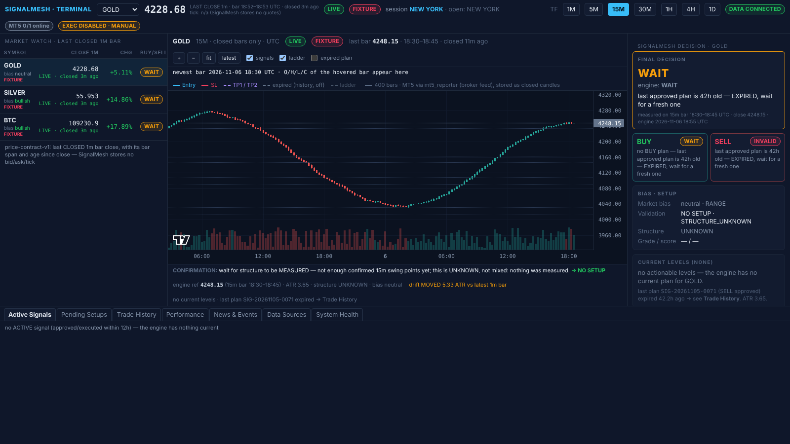
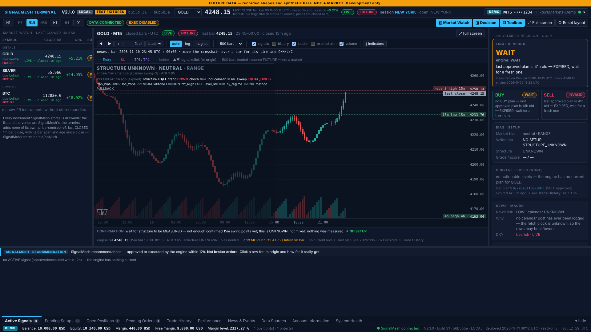
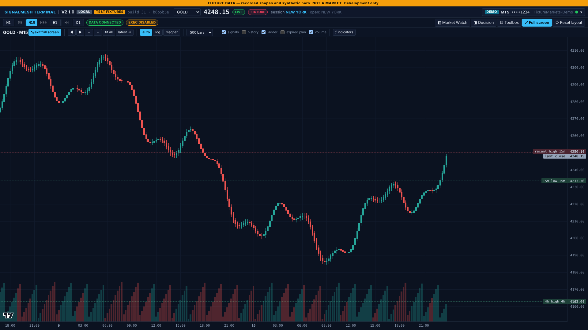
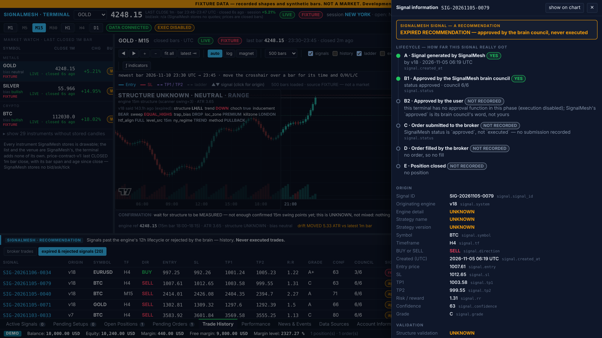
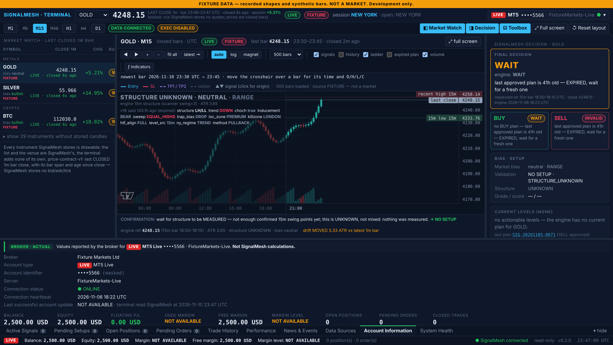
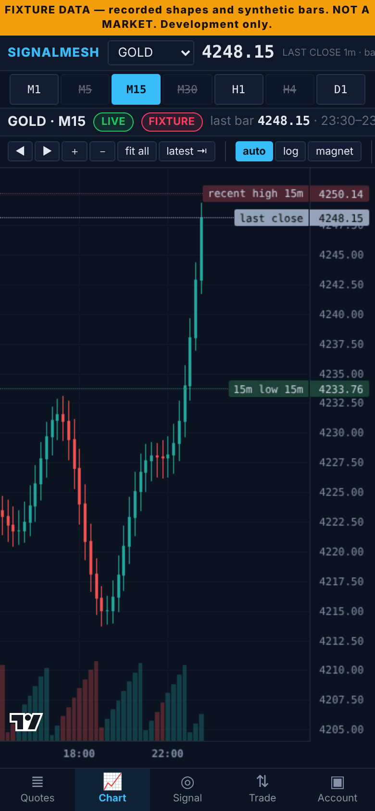
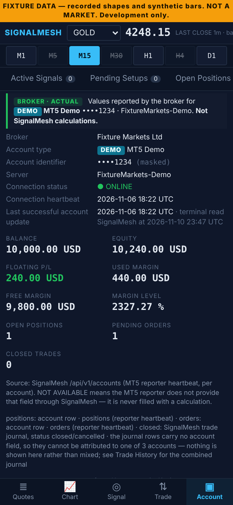

# SignalMesh Terminal — cTrader-style desktop interface (read-only)

A completely separate, professional trading-terminal UI for the existing
**SignalMesh** system (the Brother Bot platform in `sabuj14eu/Sniper-System`).
It displays everything SignalMesh already calculates, detects, validates and
records — prices, candles, structure, bias, signals, entry/SL/TP, R:R, ATR,
news, macro, freshness, trades, performance — in a cTrader-like layout.



**It changes nothing in SignalMesh.** Separate repository, separate process,
separate port, separate `.env` (`SMT_*`), read-only connection through
SignalMesh's own `/api/v1` mirror with a *read*-scoped API key. Delete this
repository and SignalMesh does not notice.

## What is where

| Part | Path | Role |
|---|---|---|
| Read-only adapter | `adapter/` | FastAPI. GETs SignalMesh `/api/v1/*`, reshapes it into the terminal contract, serves the UI. The only HTTP verb it knows is GET (asserted by a test). |
| Terminal UI | `web/` | React + TypeScript + [Lightweight Charts](https://github.com/tradingview/lightweight-charts) (Apache-2.0, open source, no TradingView subscription or widget). |
| Phase 3 parity check | `scripts/verify_parity.py` | Compares every displayed price/candle/level/status with the engine, field by field. |
| Auto check | `scripts/check.sh` | Tests + typecheck + build + read-only audit in one command (also runs in CI). |
| Deploy | `Dockerfile`, `docker-compose.yml`, `Caddyfile.snippet` | One container beside the SignalMesh stack. |
| Docs | `docs/` | Architecture, data contract, deployment, verification plan, execution roadmap (Phase 6), **`HANDOFF.md`** (where it runs, what was learned, the opening prompt for a new window). |

## Layout (V2 — a workspace, not a fixed dashboard)



The chart is the centre. Everything around it can be hidden, resized by dragging its border, and is remembered in the browser.

* **Toolbar** — symbol, last closed price with age and freshness, **account selector** (only genuinely connected accounts; DEMO / LIVE badge, masked number, server, status), MT5-style timeframe buttons (M1 … D1), workspace buttons: Market Watch · Decision · Toolbox · Full screen · Reset layout.
* **Left — Market Watch**: price, session change (engine's own number), freshness, bias, engine decision.
* **Centre — chart**: candlesticks (closed bars, UTC), wheel zoom, drag to scroll, crosshair with the bar's full timestamp and O/H/L/C, price-scale controls (auto / log / drag the axis), time-scale controls (◀ ▶ ＋ － fit all · latest), 300/500/1000 bars, latest-price marker, the engine's Entry / SL / TP1 / TP2 lines, the structural ladder, and **signal markers that open the signal's origin when clicked**. An *indicators* menu (two moving averages, off by default, display-only) shows where further studies plug in — `web/src/indicators.ts`.
* **Right — SignalMesh decision**: READY / WAIT / INVALIDATED, BUY/SELL state, levels, R:R, ATR, news, macro, freshness, invalidation, gates, manual ticket.
* **Bottom — Toolbox** (tabs along the bottom edge, as in MT5): Active Signals · Pending Setups · **Open Positions** · **Pending Orders** · Trade History · Performance · News & Events · Data Sources · **Account Information** · **Forecast Journal** · System Health. Blue-tagged tabs are SignalMesh recommendations; green-tagged tabs are the broker's own records. They are never in one table. The purple-tagged Forecast Journal is the terminal's own study record — neither of the two.
* **Status bar** — the selected account's balance, equity, margin, free margin, margin level, as the broker reported them.

| | |
|---|---|
| Full-screen chart (`F`, `Esc`) |  |
| Signal information — origin and how far it really got |  |
| Account Information — broker values, NOT AVAILABLE where the reporter sends none |  |

**On a phone** the same terminal shows one view at a time with a bottom bar — Quotes · Chart · Signal · Trade · Account — like the MT5 and TradingView apps; the chart takes the whole screen and pinch / drag work.

 

Keys: `F` full-screen chart · `Esc` leave it · `Ctrl+M` Market Watch · `Ctrl+D` Decision · `Ctrl+T` Toolbox. Double-click a border to reset its size.

## Version identification — which terminal is running

The toolbar reads `SIGNALMESH TERMINAL | V2.1.0  PRODUCTION  build 31 · b6b5b5e` (and `TEST FIXTURES` when the data is not a market). The status bar repeats it with the deployment time. Click the version for the build details and the release history.

None of it is typed:

| Shown | Comes from |
|---|---|
| Version | the one-line `VERSION` file; a test fails unless it equals the newest heading in `docs/RELEASES.md`, and another fails if the number appears anywhere in the code |
| Git commit, build number (commit count), "uncommitted changes" flag, build time | computed from the git checkout by the Dockerfile's `meta` stage into `build.json`, which both the adapter and the UI bundle read |
| Last deployment | when the running server process started |
| Environment | `SMT_ENV` → PRODUCTION / STAGING / LOCAL |
| Data on screen | `<ENVIRONMENT> DATA`, or TEST FIXTURES when the fixture provider is running |

The page in the browser carries its own copy of the build identity; if it differs from the server's, the toolbar says **RELOAD — old page**.

**Screenshots of the deployed terminal:** `scripts/screenshots.sh` on the box photographs the terminal that is running there (desktop, full-screen chart, Account Information, Active Signals, Trade History, Open Positions, Pending Orders, version panel, phone) into `screenshots/<version>-<commit>-<environment>-<data>/` with a `manifest.txt`. The pictures in this README were taken the same way from a local run and say so in their toolbar: LOCAL · TEST FIXTURES.

## Rules this code obeys

> Every instrument SignalMesh stores is drawable; the list and the venue are SignalMesh's, the terminal adds none of its own.

0000. **Forecasting studies live in the chart's "indicators" menu and are display only.** Daily forecast top / bottom and the asset ranking table (`forecast.py`, ported from the V15 Pine scripts) draw lines and a read-only report; their scenario levels are HYPOTHETICAL ANALYSIS LEVELS, recorded and scored in the forecast journal. They produce no signal and change nothing in SignalMesh.
000. **The forecast journal is the terminal's own record, and the only thing the terminal writes.** One append-only SQLite file on the terminal's own Docker volume (`journal.py`): forecasts of the terminal's display-only studies, recorded once at their closed bar with every level fixed, then scored from closed candles (`GET /journal`, Toolbox → Forecast Journal). Hit rates always carry their sample size. It is not SignalMesh's database, nothing is sent to SignalMesh, and every level is a HYPOTHETICAL ANALYSIS LEVEL.
00. **Smart Money Concepts overlays are the terminal's own display-only studies.** Support/resistance, FVG, BOS, CHoCH, order blocks, liquidity and inducement are calculated here from stored closed candles (`smc.py`, smc-v1: no lookahead, confirmed structures do not repaint, a close breaks and a wick sweeps), each switchable and labelled with its timeframe. They are not SignalMesh engine output or the Pine sensor's structure and feed no decision, level, signal or statistic.
0. **The engine's world is closed bars; the forming bar is display only.** The chart draws the bar that is still forming (SignalMesh's live bridge, else stored 1m bars) in a lighter colour so it moves like MT5, and a live price beside the closed one. Neither ever enters the closed series, a decision, a level or acceptance (`adapter/signalmesh_terminal/live.py`).
1. **Nothing is recalculated.** Every number is the engine's (`adapter/signalmesh_terminal/normalize.py` reshapes, never computes). The only logic is display selection, and each rule is named in the payload and mirrors SignalMesh's own chart page.
2. **Freshness travels with every number.** LIVE / STALE / UNKNOWN / INVALID are passed through verbatim and never upgraded. A stale price is shown as STALE with its age, never as live.
3. **One price contract.** Every price is one of: tick (n/a — SignalMesh stores none), last closed 1m bar (header), chart's last bar, engine reference (the 15m bar the decision was measured on). Each carries its bar span and age since close. See `docs/DATA_CONTRACT.md`.
4. **Provenance is the per-candle source.** SignalMesh's static "MT5 via mt5_reporter" line is shown as a platform label only; the badge next to every price comes from the candle's own `source` field (MT5 REPORTER / FIXTURE / BRIDGE / NOT MT5).
5. **Expired plans are history.** A plan past the engine's 12h lifecycle never appears as a current level; it moves to Trade History → expired & rejected plans, and is drawn on the chart only when explicitly toggled.
6. **Nothing writes to SignalMesh.** No webhook, no POST, no SignalMesh database. `tests/test_read_only.py` greps for write verbs and allows exactly one store: the terminal's own journal file.
7. **Nothing executes.** One signal becomes one broker-neutral `OrderIntent`; the MT5 and cTrader adapters can each *translate* it into their own request shape, and that is all they can do: they hold no credentials, open no connection, and `place()` refuses with 403 for every mode. Mode A prints a ticket the user places by hand.
8. **A signal is not a trade.** Every signal has an information view naming its origin field by field (`UNKNOWN` where SignalMesh says nothing) and five separate stages: generated · approved (brain council / user) · submitted · filled · closed. A broker trade belongs to a signal only when the journal row names its `signal_id` — never by resemblance.
9. **Broker figures are the broker's.** Balance, equity, margin and positions come from the MT5 reporter through SignalMesh, one account at a time, never summed or derived here. A field the reporter does not send reads NOT AVAILABLE. A total over several accounts is labelled COMBINED and belongs to no account.
11. **Public repository, pull-only box.** No production data (candles, trades, balances, account numbers, the journal) is ever committed, and no script on the box uses git or asks for a credential.
10. **Fixture data is loud.** `SMT_PROVIDER=fixture` paints a banner and is refused when `SMT_ENV=production`.

## Quick start (development)

```bash
# adapter against a real SignalMesh (read-only key from Dashboard -> API)
cd adapter && python3 -m venv .venv && . .venv/bin/activate && pip install -r requirements.txt
SMT_SIGNALMESH_URL=https://app.yourdomain.com SMT_SIGNALMESH_API_KEY=bb_... SMT_ENV=development \
  uvicorn signalmesh_terminal.main:app --port 8090
# UI with hot reload (proxies /api/terminal to :8090)
cd web && npm install && npm run dev
```

No SignalMesh at hand? `SMT_PROVIDER=fixture` serves recorded response shapes with a FIXTURE banner.

## Checks

```bash
scripts/check.sh              # unit tests, typecheck, build, read-only audit, e2e (symbol switching + V2 workspace acceptance)
scripts/check.sh --parity     # + Phase 3 parity against the engine (SM_URL, SM_KEY, TERM_URL)
```

## Deployment

See [docs/DEPLOYMENT.md](docs/DEPLOYMENT.md) — one command on the server. The
terminal is served at `https://<SignalMesh host>/terminal/` through the existing
Caddy (no new DNS) and uses the **same login as SignalMesh**: the adapter checks
the browser's SignalMesh session cookie against SignalMesh for every request, so
there is no second password or token. The SignalMesh dashboard gets one
"Terminal" menu group. Everything else — container, config, adapter, UI — stays
independent.

## Attribution

The chart is drawn with TradingView's open-source Lightweight Charts library
(Apache License 2.0). Its attribution logo in the chart corner is kept as
the license requires. No TradingView account, widget or subscription is used.
